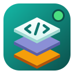

<p align="center"></p>

<h1 align="center">Stackyard Desktop</h1>

<p align="center">
Entornos de desarrollo web locales con <a href="https://ddev.com">DDEV</a>, en una app de escritorio para
<b>Windows, macOS y Linux</b>.
</p>

[Read in English](README.md)

Reescritura multiplataforma de [Stackyard](https://github.com/jaayala03/stackyard) (GTK, solo Linux) con
**Electron + React + TypeScript**. Terminal: xterm.js + node-pty.

## Estado

Versión 0.1, en desarrollo. Incluye:

- Lista de proyectos con estado, búsqueda y actualización automática; iniciar, detener, reiniciar y eliminar
- Crear, clonar o añadir un proyecto (Laravel, WordPress, Symfony, Drupal, CodeIgniter, CakePHP, Craft, PHP, Node.js…)
- Terminal integrada para cada acción; SSH y logs
- Pestañas **Git**, **Código** (editor), **.env**, **Base de datos** (importar/exportar, phpMyAdmin), **Snapshots**,
  **Compartir** (túnel público), **Deploy** (pm2) y **Node** (servicios backend/frontend)
- Bandeja del sistema, notificaciones, apagado de proyectos inactivos y aviso de actualizaciones
- Español e inglés, tema claro y oscuro

## Requisitos

[Docker](https://www.docker.com/products/docker-desktop/) y [DDEV](https://ddev.readthedocs.io/en/stable/users/install/)
instalados (en Windows, DDEV con Docker Desktop o WSL2). La app avisa si falta alguno.

## Desarrollo

```bash
npm install
npm run dev        # ejecutar con recarga en caliente
npm test           # pruebas unitarias
npm run typecheck
npm run dist:win   # instalador en dist/ (también dist:linux, dist:mac)
```

En Windows los proyectos nuevos se crean por defecto en `D:\laragon\www` (si existe) y en `~/projects` en el resto;
se cambia en Ajustes.

## Licencia y términos

- Código bajo licencia [MIT](LICENSE).
- [Términos de uso y privacidad](TERMINOS.md) ([English](TERMS.md)): sin garantía; la app no recopila datos.
- Stackyard es un proyecto **independiente**, no afiliado al proyecto
  [DDEV](https://github.com/ddev/ddev) ni a Docker. Sus nombres son marcas de sus titulares.
