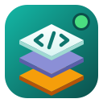

<p align="center"></p>

<h1 align="center">Stackyard Desktop</h1>

<p align="center">
Local web development environments powered by <a href="https://ddev.com">DDEV</a>, in a native desktop app for
<b>Windows, macOS and Linux</b>.
</p>

[Leer en español](README.es.md)

Cross-platform rewrite of [Stackyard](https://github.com/jaayala03/stackyard) (GTK, Linux only) using
**Electron + React + TypeScript**. Terminal: xterm.js + node-pty.

## Status

Version 0.1, work in progress. Includes:

- Project list with live status, search and auto refresh; start, stop, restart, delete
- Create, clone or add a project (Laravel, WordPress, Symfony, Drupal, CodeIgniter, CakePHP, Craft, PHP, Node.js…)
- Embedded terminal for every action; SSH and logs
- **Git**, **Code** (editor), **.env**, **Database** (import/export, phpMyAdmin), **Snapshots**, **Share** (public tunnel),
  **Deploy** (pm2) and **Node** (backend/frontend services) tabs
- Tray icon, notifications, auto-stop of idle projects and update notice
- English and Spanish, light and dark themes

Not yet tested against a real DDEV install on every platform.

## Requirements

[Docker](https://www.docker.com/products/docker-desktop/) and [DDEV](https://ddev.readthedocs.io/en/stable/users/install/)
installed (on Windows, DDEV with Docker Desktop or WSL2). The app tells you if either is missing.

## Development

```bash
npm install
npm run dev        # run with hot reload
npm test           # unit tests
npm run typecheck
npm run dist:win   # installer in dist/ (also dist:linux, dist:mac)
```

New projects are created by default in `D:\laragon\www` on Windows (when it exists) and `~/projects` elsewhere;
change it in Settings.

## License and terms

- Code under the [MIT](LICENSE) license.
- [Terms of use and privacy](TERMS.md) ([en español](TERMINOS.md)): no warranty; the app collects no data.
- Stackyard is an **independent** project, not affiliated with the [DDEV](https://github.com/ddev/ddev) project or Docker. Their names are trademarks of their owners.
